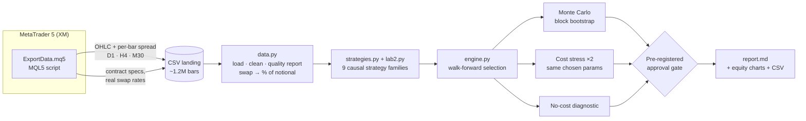

# Trading Strategy Validation Lab

**An end-to-end pipeline that extracts market data from MetaTrader 5 and tries hard to prove a trading strategy wrong (walk-forward, Monte Carlo, cost stress and pre-registered criteria) before a single real dollar is risked.**

[](https://github.com/samvie1232/trading-strategy-validation-lab/actions/workflows/ci.yml)


🇪🇸 [Versión en español](README.es.md)

---

## TL;DR

| | |
|---|---|
| **Question** | Can a retail algorithm make money at real broker and exchange costs once *all* costs are counted? |
| **Data** | 13 markets (gold, silver, oil, FX, US/EU indices, crypto) · daily and 4-hour bars since 2015 · 30-minute bars since 2021 · **~1.2M bars with per-bar spread** plus the broker's current swap rates · BTC and ETH funding from a third-party Binance dataset |
| **Tested** | 11 strategy families from research, books and trader forums · 53 parameter sets · 12,000+ out-of-sample trades |
| **Answer** | **No, not for these strategies.** None of them passes out-of-sample once costs are included. The engine rejects data with no edge and detects edges planted on purpose. |

| Strategy family | Out-of-sample period | OOS trades | OOS Sharpe | OOS annual return | Sharpe with no costs* | Verdict |
|---|---|---:|---:|---:|---:|---|
| Multi-market trend following (D1) | 2017 → 2026 | 390 | −0.18 | −0.9% | 0.22 | ❌ |
| Intraday momentum, US indices (M30) | 2023 → 2026 | 2,391 | −1.83 | −10.5% | −0.69 | ❌ |
| Asian-range breakout (M30) | 2023 → 2026 | 2,446 | −1.67 | −7.7% | 0.55† | ❌ |
| Connors RSI(2), indices (D1, long only) | 2017 → 2026 | 264 | 0.31 | +1.3% | 0.46 | ❌ Below Sharpe 0.5 |
| RSI(2), gold and US500 (M30) | 2023 → 2026 | 1,234 | −0.63 | −1.7% | 0.53 | ❌ |
| Channel breakout, gold (H1) | 2023 → 2026 | 1,084 | −1.52 | −15.3% | −0.74 | ❌ |
| Quick exits, 64% win rate (M30) | 2023 → 2026 | 2,572 | −2.01 | −8.3% | 0.42 | ❌ |
| Quick exits + cost filter (M30) | 2023 → 2026 | 1,248 | −0.79 | −2.9% | 0.16 | ❌ |
| Gold/silver relative value (H4) | 2017 → 2026 | 78 | −1.07 | −7.8% | −0.58 | ❌ |
| Month-turn effect, indices (D1, long only) | 2017 → 2026 | 468 | 0.25 | +1.0% | 0.43 | ❌ No better than random windows |
| Delta-neutral funding carry, BTC and ETH | 2022 → Apr 2026 | 9‡ | 2.32‡ | +0.7%‡ | 3.99‡ | ❌ Barely above cash |

\* No spread, slippage or swap. Reference only; it never counts toward approval.

‡ Excess over an assumed 4% cash return, annualized over 365 days. The 9 trades collected 2,514 funding payments. The high Sharpe reflects a very smooth daily curve and misses platform and intraday risk.

† Matches what the same code produces on pure random-walk data (Sharpe 0.55 vs 0.49), so it is a fill-model artifact, not an edge. See [Findings](#findings).

> A negative result, proven rigorously, is the most valuable output a validation pipeline can produce: it is the result that saves money.

---

## Why this project exists

I started by building an Expert Advisor for gold in MQL5 ([`mql5/GoldGuardian.mq5`](mql5/GoldGuardian.mq5)) with fixed-fraction risk sizing, daily and max-drawdown kill switches, a losing-streak pause, and spread, session and news filters. The MetaTrader strategy tester told a familiar story:

| GoldGuardian v1.2 | In-sample (Jan 2024 – Nov 2025) | Out-of-sample (Nov 2025 – Oct 2026) |
|---|---:|---:|
| Trades | 67 | 32 |
| Net result | **+6.8%** | **−12.6%** |
| Profit factor | 1.24 | 0.56 |
| Max drawdown | 5.3% | 18.0% |

The backtest looked profitable; out-of-sample, it lost money. Version 1.3 hardens the EA's risk controls without changing its entries, and reproduces the result: 32 trades, −12.4%, profit factor 0.57. Better safeguards made it safer to operate, not profitable. The earlier versions had also taught me how easy it is to fool yourself: v1 traded only 13 times in two years, and the "fix" I first assumed (a spread filter) turned out to be the wrong diagnosis. The real cause was a pair of entry conditions that almost never hold on the same bar.

So instead of tuning the bot until the chart looked nice, I built a lab whose only job is to **reject** strategies unless the evidence is overwhelming.

---

## Architecture



| Layer | What it does |
|---|---|
| **Extraction** (`mql5/ExportData.mq5`) | Forces history download from the broker server, exports OHLC with the **spread of every bar**, contract specs (point, tick value, contract size) and real long/short swaps for any list of symbols. |
| **Ingestion** (`data.py`) | Typed parsing, de-duplication, sanity filters, spread back-fill from current specs, a data-quality table (bars, coverage, gaps, median spread in bps), and conversion of each swap mode (points, interest, currency) into a per-night % of notional. |
| **Strategies** (`strategies.py`, `lab2.py`) | Nine families, all strictly causal. Each returns daily returns as a fraction of equity plus a trade ledger. |
| **Validation** (`engine.py`) | Rolling walk-forward (2-year train, 6-month test), block-bootstrap Monte Carlo (2,000 paths), a cost stress test that reuses the exact parameters chosen per window, and the approval gate. |
| **Lab v2** (`lab2.py`, `lab2_run.py`, `lab2_controls.py`) | Pre-registered hypotheses, Deflated Sharpe, random-entry baseline and controls built from the real data. |
| **Reporting** (`run.py`) | One markdown report with the verdict, criteria table, parameter-sensitivity table, per-window detail, per-symbol breakdown and equity charts. |

---

## Methodology

**Realistic costs, not idealized fills**
- Spread taken from each historical bar, plus 25% slippage per trade.
- Stop orders (breakouts and stop-losses) fill half a spread *worse* than the level.
- The broker's current overnight swaps for multi-day positions, including the weekend effect, applied as a constant % of notional because historical swap rates are not available.
- Volatility-targeted position sizing (10% annual per market for trend, 0.5% equity risk per intraday trade).

**Walk-forward, not one lucky split.** For every 6-month window, the best parameter set is chosen *only* on the previous 2 years, then frozen and applied to the next 6 months. Only the chained out-of-sample segments count.

**Pre-registered approval criteria.** These are defined in `config.py` *before* looking at results, and a strategy must meet all six:

| Criterion | Threshold |
|---|---|
| Out-of-sample trades | ≥ 100 |
| Out-of-sample Sharpe | ≥ 0.5 |
| Walk-forward efficiency (OOS / IS return) | ≥ 0.5 |
| Profitable OOS windows | ≥ 55% |
| Monte Carlo 95th-percentile drawdown | ≤ 25% |
| Sharpe with **double** costs | ≥ 0.2 |

**Trust, but verify the verifier.** The test suite (run in CI on every push) checks the engine itself:

| Test | What it proves |
|---|---|
| **Negative control** | On synthetic random-walk data (no edge can exist), all three families must be rejected. |
| **Positive control** | When a real effect is planted on purpose (persistent drift regimes; last-half-hour following first-half-hour), the engine must detect and approve it, and must still reject the family where nothing was planted. |
| **No look-ahead** | The signal for day *k* computed with data up to *k* must equal the one computed with the full history. Validated by mutation testing: 4 out of 4 deliberately injected future leaks are caught. |
| **Cost monotonicity** | Higher costs can never improve results. |

**Lab v2 adds three safeguards:**
- **Pre-registration.** [Rules, parameters and criteria](results/lab2/PREREGISTRO.md) were written before running real data. Two amendments made after the controls, and before any real result, are disclosed there. It is an internal record, not certified by a third party.
- **Deflated Sharpe ≥ 0.95**, counting all 44 parameter sets, because the best of many tries looks good by chance.
- **Random-entry baseline.** Quick-exit strategies must beat the 95th percentile of random entries with the same exits.

Lab v2's controls shuffle the real bars and plant known effects: 0 of 18 shuffled runs were approved, and all 6 families detected the planted effect. That run also caught a real bug in the gold/silver z-score before any real result was produced.

---

## Findings

<p align="center"></p>

**1. Trend following: execution is not the problem.** Trend following has more than a century of evidence behind it, but it needs to hold positions for weeks, and on CFDs every night costs money. Removing spreads changes almost nothing (−0.9% → −0.8% a year), so execution is not what decides the result. Swaps matter: without them the Sharpe rises from −0.18 to 0.20, still below the 0.5 required. Only 45% of out-of-sample windows are profitable.

*Correction (Nov 2026):* the first version of this analysis divided today's fixed swap by each historical price, which made old financing too expensive (gold in 2017: about −22.8%/year vs −6.4% in 2026). It reported a Sharpe of −0.46 and a BTCUSD loss of −26%/year. The swap is now a constant % of notional. The verdict is unchanged, but BTCUSD and ETHUSD are now positive over the full sample with the most-selected parameters (21 and 17 trades), so that earlier claim was withdrawn. Today's rates still overstate the low-rate years, which is why the zero-swap case is reported too.

<p align="center"></p>

**2. Intraday momentum on US indices: no effect at all.** The academic finding (the first half hour predicts the last half hour) does not show up in these CFDs during 2021–2026. Every parameter set and every index loses money, the strategy is negative even before costs, and 0% of the out-of-sample windows are profitable.

<p align="center"></p>

**3. Asian-range breakout: a lesson about fill models.** During development, the negative control caught an **optimistic fill bias**: filling breakout entries exactly at the level made a pure random walk look profitable (Sharpe 1.3). I fixed it with adverse slippage on stop fills plus finer synthetic paths, and kept the "no-cost" diagnostic only as a reference. On real data the strategy loses in all three markets after costs.

**4. Lab v2: methods traders actually share.** I took candidates from forums, books and commercial bots, using public rules only, and fixed the tests in advance:

- **Quick exits do not create an edge.** They won 64% of the time and still lost 8.3% a year. The result stayed below the 95th percentile of random entries (92nd). In a no-edge market, moving a stop and target changes the win rate, not the expected loss of the spread.
- **Costs dominate at short horizons.** RSI(2) on M30 goes from Sharpe 0.53 with no costs to −0.63 with them. Shuffled data reached similar no-cost values, so even that figure may be noise.
- **Connors RSI(2) on daily indices is the closest:** Sharpe 0.31, 0.42 without swap and 0.46 with no costs, all below the 0.5 required. Its Deflated Sharpe is 0.20 in the corrected run, against 0.95 required.
- **Commercial bots were not bought or audited.** The H1 breakout tests a generic public rule of that style, not any vendor's code, so it says nothing about a specific product.

**5. Structural ideas: a real payment, too small after costs.** I then tested two ideas with an economic reason behind them, again with rules written in advance:

- **Funding carry is real but compressed.** BTC funding fell from about 30.6% a year in 2021 to 5.1% in 2025 and 1.3% in early 2026. It passed five of eight criteria, but earned only 0.68% a year above the cash assumption and about −0.1% over the last 24 months. Daily data cannot see exchange failure or auto-deleveraging, so even a pass would not justify real money by itself.
- **The month-turn effect did not beat chance.** The average trade landed at the 57th percentile of random windows of the same length, so it looks like ordinary market exposure.

Buying and holding US500Cash returned 6.3% a year in the same period (Sharpe 0.43, 34.6% drawdown), a context figure rather than part of the test.

Reports: [Lab v2 results](results/lab2/RESULTADOS.md) · [core families, Nov 2026](results/report_2026-11-04.md) · [original Oct 2026 report](results/report_2026-10-22.md) · [funding carry](results/funding/RESULTADOS.md) · [month turn](results/tom/RESULTADOS.md).

---

## Engineering decisions worth noting

- **Causality by construction.** Channels use `shift(1)`, signals are decided on the close and executed from the next bar, and intraday sizing uses lagged volatility.
- **The stress test reuses the parameters chosen per window.** An earlier version re-ran the selection under doubled costs and sometimes produced a "double cost" curve *above* the base case. The fix makes the comparison apples-to-apples.
- **Conservative intrabar assumptions.** With 30-minute bars the order of the high and low is unknown, so when a bar touches both the stop and the target, the stop wins.
- **Synthetic data generator** (`make_synthetic.py`) writes the exact MT5 export format, so anyone can run the full pipeline without a broker account.

---

## Quickstart

```bash
git clone https://github.com/samvie1232/trading-strategy-validation-lab.git
cd trading-strategy-validation-lab/research
pip install -r requirements.txt -r requirements-dev.txt

# 1) Verify the engine (negative/positive controls, look-ahead, costs)
pytest -q tests

# 2) Run on synthetic data (expected: every family "NO APRUEBA")
python make_synthetic.py
XM_DATA_DIR=data_synthetic XM_OUT_DIR=output_synthetic python run.py
```

Lab v2 needs the real XM export in `research/data/`:

```bash
python lab2_controls.py
XM_OUT_DIR=output_lab2 python lab2_run.py                                # corrected swap
XM_SWAP_MODEL=legacy_fixed XM_OUT_DIR=output_lab2_prereg python lab2_run.py  # as pre-registered
```

**With real broker data:**
1. In MT5, set *Tools → Options → Charts → Max bars in chart* to *Unlimited*, then add the markets you want to Market Watch.
2. Copy `mql5/ExportData.mq5` to `MQL5/Scripts`, compile it (F7) and run it on any chart.
3. Copy the CSVs from `Terminal/Common/Files/xm_research` into `research/data/`.
4. Run `python run.py` and open `research/output/report.md`.

---

## Repository structure

```
├── mql5/
│   ├── ExportData.mq5        # MT5 → CSV extractor (history, spreads, specs, swaps)
│   └── GoldGuardian.mq5      # Gold EA v1.3 (risk controls, decision log, signal-only mode, alerts)
├── research/
│   ├── config.py             # Universe, costs, parameter grids, PRE-REGISTERED approval criteria
│   ├── data.py               # Ingestion, quality checks, swap normalization
│   ├── strategies.py         # Trend (EMA / Donchian / TS-momentum), intraday momentum, Asian breakout
│   ├── engine.py             # Walk-forward, Monte Carlo, approval gate
│   ├── metrics.py            # Sharpe, CAGR, drawdown, trade stats
│   ├── run.py                # Orchestration + markdown/PNG/CSV report
│   ├── lab2.py               # Lab v2: six pre-registered families and Deflated Sharpe
│   ├── lab2_run.py           # Runs Lab v2 on real data
│   ├── lab2_controls.py      # Shuffled and planted-effect controls
│   ├── lab_funding*.py       # Funding carry test (needs a funding dataset in data_funding/)
│   ├── lab_tom*.py           # Month-turn test with a random-window baseline
│   ├── make_synthetic.py     # Synthetic data in MT5 export format
│   └── tests/                # Controls, look-ahead, cost monotonicity
├── results/                  # Real-data reports (Oct and Nov 2026) and Lab v2 records
└── docs/img/                 # Equity charts
```

---

## Limitations and next steps

- No historical swap data: today's rates are applied to the full history, which overstates costs in low-rate years. Results are also reported with no swap.
- Spreads come from a demo account, and slippage is assumed rather than measured live.
- Funding data comes from a third-party repository, ends in April 2026, and uses fee levels from secondary sources.
- These results cover the strategies tested at these costs. They do not prove that no profitable strategy exists.
- 30-minute bars cannot resolve the price path inside a bar; tick data would remove that assumption.
- One broker and one cost structure. A natural next experiment is running the same engine on **exchange-traded futures or ETFs**, where there is no daily CFD swap and costs are lower.
- Planned: Parquet storage, orchestration (Airflow/Prefect) for scheduled refreshes, and a Power BI dashboard on the walk-forward outputs.

---

## Disclaimer

This is a research and engineering project, not investment advice. It was run on a demo account. The conclusion of the research is, explicitly, that these strategies should **not** be traded.

---

**Santiago Martínez** · Data Engineer · [LinkedIn](https://www.linkedin.com/in/santiago-martinez-dataengineer) · [GitHub](https://github.com/samvie1232)
