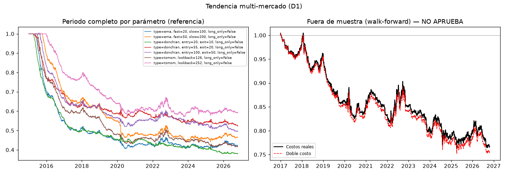
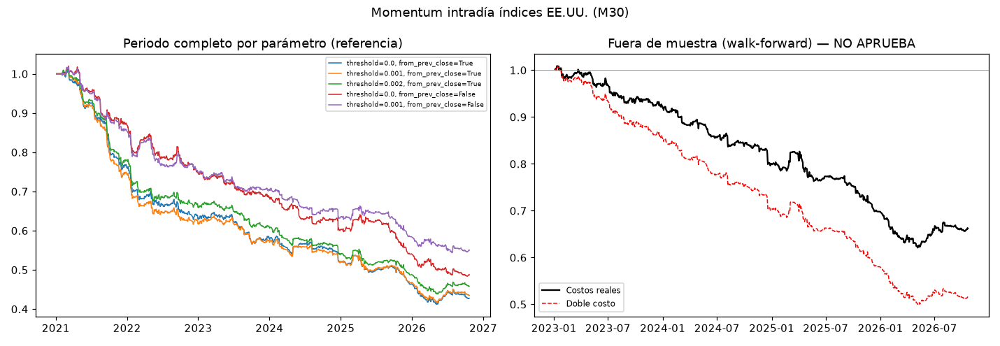
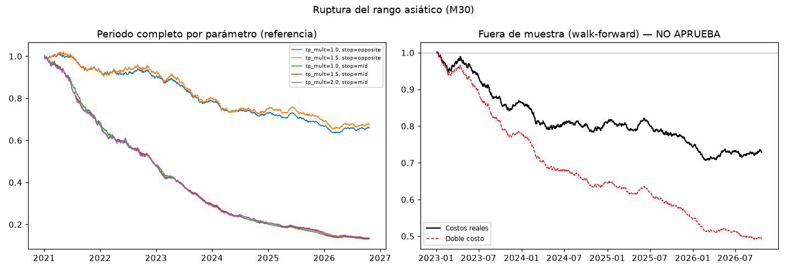

# Trading Strategy Validation Lab

**An end-to-end pipeline that extracts market data from MetaTrader 5 and tries hard to prove a trading strategy wrong (walk-forward, Monte Carlo, cost stress and pre-registered criteria) before a single real dollar is risked.**

[](https://github.com/samvie1232/trading-strategy-validation-lab/actions/workflows/ci.yml)


🇪🇸 [Versión en español](README.es.md)

---

## TL;DR

| | |
|---|---|
| **Question** | Can a retail algorithm make money trading CFDs at a real broker (XM, MT5) once *all* costs are counted? |
| **Data** | 13 markets (gold, silver, oil, FX, US/EU indices, crypto) · daily and 4-hour bars since 2015 · 30-minute bars since 2021 · **~1.1M bars with per-bar spread** plus the broker's real swap rates |
| **Tested** | 3 strategy families with academic or practitioner backing · 17 parameter sets · 5,300+ out-of-sample trades |
| **Answer** | **No.** None of them survives out-of-sample once real spreads and swaps are included. The engine also proved *why* in each case. |

| Strategy family | Out-of-sample period | OOS Sharpe | OOS annual return | Before trading costs | Verdict |
|---|---|---:|---:|---:|---|
| Multi-market trend following (D1) | 2017 → 2026 | −0.46 | −2.1% | −2.0% | ❌ No trend premium left after overnight swaps |
| Intraday momentum, US indices (M30) | 2023 → 2026 | −1.82 | −10.5% | −4.2% | ❌ No edge even before costs |
| Asian-range breakout (M30) | 2023 → 2026 | −1.64 | −7.7% | +2.7%* | ❌ Loses after costs in every market |

\* The "before costs" figure for breakouts matches what the same code produces on pure random-walk data (Sharpe 0.57 vs 0.49), so it is a fill-model artifact, not an edge. See [Findings](#findings).

> A negative result, proven rigorously, is the most valuable output a validation pipeline can produce: it is the result that saves money.

---

## Why this project exists

I started by building an Expert Advisor for gold in MQL5 ([`mql5/GoldGuardian.mq5`](mql5/GoldGuardian.mq5)) with fixed-fraction risk sizing, daily and max-drawdown kill switches, a losing-streak pause, and spread, session and news filters. The MetaTrader strategy tester told a familiar story:

| GoldGuardian v1.2 | In-sample (Jan 2024 – Nov 2025) | Out-of-sample (Nov 2025 – Oct 2026) |
|---|---:|---:|
| Trades | 67 | 32 |
| Net result | **+6.8%** | **−12.6%** |
| Profit factor | 1.24 | 0.56 |
| Max drawdown | 5.3% | 18.0% |

The backtest looked profitable; out-of-sample, it lost money. The earlier versions had also taught me how easy it is to fool yourself: v1 traded only 13 times in two years, and the "fix" I first assumed (a spread filter) turned out to be the wrong diagnosis. The real cause was a pair of entry conditions that almost never hold on the same bar.

So instead of tuning the bot until the chart looked nice, I built a lab whose only job is to **reject** strategies unless the evidence is overwhelming.

---

## Architecture


| Layer | What it does |
|---|---|
| **Extraction** (`mql5/ExportData.mq5`) | Forces history download from the broker server, exports OHLC with the **spread of every bar**, contract specs (point, tick value, contract size) and real long/short swaps for any list of symbols. |
| **Ingestion** (`data.py`) | Typed parsing, de-duplication, sanity filters, spread back-fill from current specs, a data-quality table (bars, coverage, gaps, median spread in bps), and conversion of each swap mode (points, interest, currency) into a per-night % of notional. |
| **Strategies** (`strategies.py`) | Three families, all strictly causal. Each returns daily returns as a fraction of equity plus a trade ledger. |
| **Validation** (`engine.py`) | Rolling walk-forward (2-year train, 6-month test), block-bootstrap Monte Carlo (2,000 paths), a cost stress test that reuses the exact parameters chosen per window, and the approval gate. |
| **Reporting** (`run.py`) | One markdown report with the verdict, criteria table, parameter-sensitivity table, per-window detail, per-symbol breakdown and equity charts. |

---

## Methodology

**Realistic costs, not idealized fills**
- Spread taken from each historical bar, plus 25% slippage per trade.
- Stop orders (breakouts and stop-losses) fill half a spread *worse* than the level.
- The broker's real overnight swaps for multi-day positions, including the weekend triple swap.
- Volatility-targeted position sizing (10% annual per market for trend, 0.5% equity risk per intraday trade).

**Walk-forward, not one lucky split.** For every 6-month window, the best parameter set is chosen *only* on the previous 2 years, then frozen and applied to the next 6 months. Only the chained out-of-sample segments count.

**Pre-registered approval criteria.** These are defined in `config.py` *before* looking at results, and a strategy must meet all six:

| Criterion | Threshold |
|---|---|
| Out-of-sample trades | ≥ 100 |
| Out-of-sample Sharpe | ≥ 0.5 |
| Walk-forward efficiency (OOS / IS return) | ≥ 0.5 |
| Profitable OOS windows | ≥ 55% |
| Monte Carlo 95th-percentile drawdown | ≤ 25% |
| Sharpe with **double** costs | ≥ 0.2 |

**Trust, but verify the verifier.** The test suite (run in CI on every push) checks the engine itself:

| Test | What it proves |
|---|---|
| **Negative control** | On synthetic random-walk data (no edge can exist), all three families must be rejected. |
| **Positive control** | When a real effect is planted on purpose (persistent drift regimes; last-half-hour following first-half-hour), the engine must detect and approve it, and must still reject the family where nothing was planted. |
| **No look-ahead** | The signal for day *k* computed with data up to *k* must equal the one computed with the full history. Validated by mutation testing: 4 out of 4 deliberately injected future leaks are caught. |
| **Cost monotonicity** | Higher costs can never improve results. |

---

## Findings

<p align="center"></p>

**1. Trend following: execution is not the problem.** Trend following has more than a century of evidence behind it, but it needs to hold positions for weeks, and on CFDs every night costs money. With XM's real crypto swaps, BTCUSD's trend system loses −26%/year. Removing spreads changes almost nothing (−2.1% → −2.0%), so the losses come from overnight financing and from the lack of a trend premium in this period, not from execution. *Caveat:* today's swap rates are applied to the whole history, which overstates costs in 2015–2021, when rates were near zero. Results are still negative in 2023–2026, when rates were similar to today's.

<p align="center"></p>

**2. Intraday momentum on US indices: no effect at all.** The academic finding (the first half hour predicts the last half hour) does not show up in these CFDs during 2021–2026. Every parameter set and every index loses money, the strategy is negative even before costs, and 0% of the out-of-sample windows are profitable.

<p align="center"></p>

**3. Asian-range breakout: a lesson about fill models.** During development, the negative control caught an **optimistic fill bias**: filling breakout entries exactly at the level made a pure random walk look profitable (Sharpe 1.3). I fixed it with adverse slippage on stop fills plus finer synthetic paths, and kept the "no-cost" diagnostic only as a reference. On real data the strategy loses in all three markets after costs.

Full report with every number: [`results/report_2026-10-22.md`](results/report_2026-10-22.md).

---

## Engineering decisions worth noting

- **Causality by construction.** Channels use `shift(1)`, signals are decided on the close and executed from the next bar, and intraday sizing uses lagged volatility.
- **The stress test reuses the parameters chosen per window.** An earlier version re-ran the selection under doubled costs and sometimes produced a "double cost" curve *above* the base case. The fix makes the comparison apples-to-apples.
- **Conservative intrabar assumptions.** With 30-minute bars the order of the high and low is unknown, so when a bar touches both the stop and the target, the stop wins.
- **Synthetic data generator** (`make_synthetic.py`) writes the exact MT5 export format, so anyone can run the full pipeline without a broker account.

---

## Quickstart

```bash
git clone https://github.com/samvie1232/trading-strategy-validation-lab.git
cd trading-strategy-validation-lab/research
pip install -r requirements.txt -r requirements-dev.txt

# 1) Verify the engine (negative/positive controls, look-ahead, costs)
pytest -q tests

# 2) Run on synthetic data (expected: every family "NO APRUEBA")
python make_synthetic.py
XM_DATA_DIR=data_synthetic XM_OUT_DIR=output_synthetic python run.py
```

**With real broker data:**
1. In MT5, set *Tools → Options → Charts → Max bars in chart* to *Unlimited*, then add the markets you want to Market Watch.
2. Copy `mql5/ExportData.mq5` to `MQL5/Scripts`, compile it (F7) and run it on any chart.
3. Copy the CSVs from `Terminal/Common/Files/xm_research` into `research/data/`.
4. Run `python run.py` and open `research/output/report.md`.

---

## Repository structure

```
├── mql5/
│   ├── ExportData.mq5        # MT5 → CSV extractor (history, spreads, specs, swaps)
│   └── GoldGuardian.mq5      # The original gold EA (risk kill switches, filters, CSV trade log)
├── research/
│   ├── config.py             # Universe, costs, parameter grids, PRE-REGISTERED approval criteria
│   ├── data.py               # Ingestion, quality checks, swap normalization
│   ├── strategies.py         # Trend (EMA / Donchian / TS-momentum), intraday momentum, Asian breakout
│   ├── engine.py             # Walk-forward, Monte Carlo, approval gate
│   ├── metrics.py            # Sharpe, CAGR, drawdown, trade stats
│   ├── run.py                # Orchestration + markdown/PNG/CSV report
│   ├── make_synthetic.py     # Synthetic data in MT5 export format
│   └── tests/                # Controls, look-ahead, cost monotonicity
├── results/                  # Report from the real-data run (Oct 2026)
└── docs/img/                 # Equity charts
```

---

## Limitations and next steps

- Swaps use today's broker rates for the full history (conservative for 2015–2021).
- 30-minute bars cannot resolve the price path inside a bar; tick data would remove that assumption.
- One broker and one cost structure. The obvious next experiment is running the same engine on **exchange-traded futures or ETFs**, where there is no daily CFD swap and costs are lower.
- Planned: Parquet storage, orchestration (Airflow/Prefect) for scheduled refreshes, and a Power BI dashboard on the walk-forward outputs.

---

## Disclaimer

This is a research and engineering project, not investment advice. It was run on a demo account. The conclusion of the research is, explicitly, that these strategies should **not** be traded.

---

**Santiago Martínez** · Data Engineer · [LinkedIn](https://www.linkedin.com/in/santiago-martinez-dataengineer) · [GitHub](https://github.com/samvie1232)
