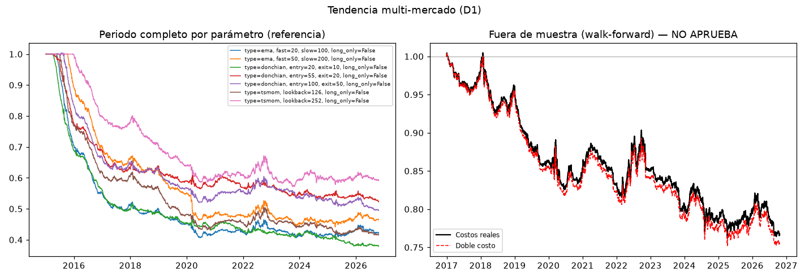
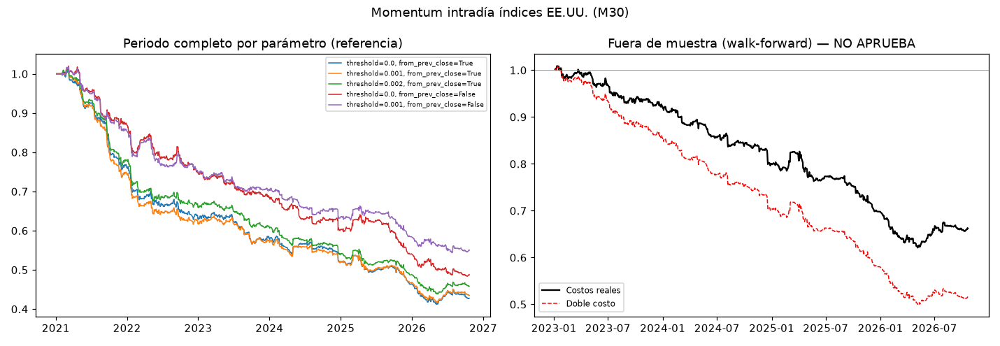
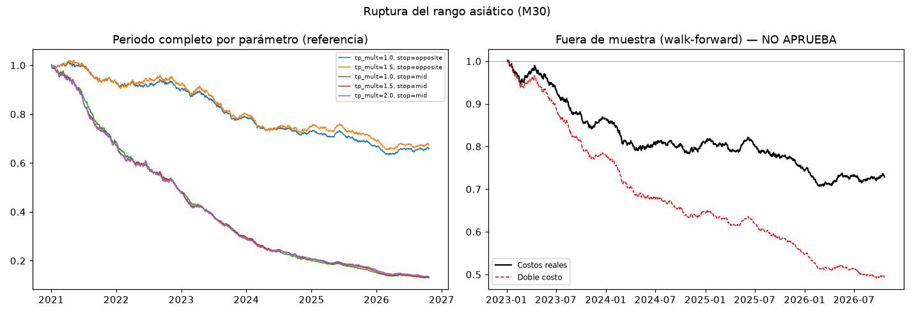

# Informe de investigación

Generado: 2026-10-22 01:08. Costos: spread real x1.0 + deslizamiento 25% del spread; swaps reales de XM. Walk-forward: entrenar 2 años, probar 6 meses.

## Resumen

| familia | veredicto | Sharpe OOS | retorno anual OOS | caída máx. OOS | operaciones OOS |
| --- | --- | --- | --- | --- | --- |
| Tendencia multi-mercado (D1) | NO APRUEBA | -0.46 | -2.1% | 24.1% | 512 |
| Momentum intradía índices EE.UU. (M30) | NO APRUEBA | -1.82 | -10.5% | 38.4% | 2371 |
| Ruptura del rango asiático (M30) | NO APRUEBA | -1.64 | -7.7% | 29.5% | 2426 |

## Tendencia multi-mercado (D1)

**Datos usados**

| símbolo | bars | start | end | gaps_over_4_days | median_spread_bps |
| --- | --- | --- | --- | --- | --- |
| BTCUSD | 3451 | 2015-01-01 | 2026-10-22 | 3 | 17.19 |
| ETHUSD | 3183 | 2016-11-08 | 2026-10-22 | 0 | 21.27 |
| EURUSD | 3099 | 2015-01-02 | 2026-10-22 | 0 | 1.44 |
| GBPUSD | 3099 | 2015-01-02 | 2026-10-22 | 0 | 1.4 |
| GER40Cash | 3001 | 2015-01-02 | 2026-10-22 | 20 | 3.4 |
| GOLD | 3047 | 2015-01-02 | 2026-10-22 | 0 | 1.58 |
| OILCash | 3050 | 2015-01-02 | 2026-10-22 | 0 | 9.08 |
| SILVER | 3048 | 2015-01-02 | 2026-10-22 | 0 | 15.97 |
| US100Cash | 3049 | 2015-01-02 | 2026-10-22 | 1 | 1.62 |
| US30Cash | 3049 | 2015-01-02 | 2026-10-22 | 1 | 1.03 |
| US500Cash | 3049 | 2015-01-02 | 2026-10-22 | 1 | 1.92 |
| USDCHF | 3099 | 2015-01-02 | 2026-10-22 | 0 | 2.08 |
| USDJPY | 3099 | 2015-01-02 | 2026-10-22 | 0 | 1.36 |

**Sensibilidad de parámetros (periodo completo, solo referencia)**

Si solo un parámetro funciona y sus vecinos no, es señal de sobreajuste.

| parámetros | retorno anual | Sharpe | caída máx. | operaciones | factor beneficio |
| --- | --- | --- | --- | --- | --- |
| type=ema, fast=20, slow=100, long_only=False | -5.7% | -1.26 | 59.4% | 478 | 0.35 |
| type=ema, fast=50, slow=200, long_only=False | -5.1% | -1.16 | 55.9% | 236 | 0.26 |
| type=donchian, entry=20, exit=10, long_only=False | -6.4% | -1.55 | 62.1% | 1227 | 0.44 |
| type=donchian, entry=55, exit=20, long_only=False | -4.3% | -1.10 | 47.7% | 561 | 0.43 |
| type=donchian, entry=100, exit=50, long_only=False | -4.7% | -1.14 | 50.7% | 278 | 0.33 |
| type=tsmom, lookback=126, long_only=False | -5.8% | -1.29 | 58.5% | 1293 | 0.40 |
| type=tsmom, lookback=252, long_only=False | -3.5% | -0.83 | 43.0% | 1035 | 0.41 |

### Veredicto: **NO APRUEBA**

Diagnóstico (no cuenta para el veredicto): **sin spread ni deslizamiento** el resultado fuera de muestra sería Sharpe -0.43 y retorno anual -2.0%. Si aquí es positivo y con costos negativo, la idea tiene algo pero los costos de XM se la comen.

| criterio | valor | resultado |
| --- | --- | --- |
| Operaciones fuera de muestra | 512 (mín. 100) | OK |
| Sharpe fuera de muestra | -0.46 (mín. 0.5) | FALLA |
| Eficiencia walk-forward | n/d (IS ≤ 0) | FALLA |
| Ventanas OOS positivas | 40% (mín. 55%) | FALLA |
| Caída p95 Monte Carlo | 42.6% (máx. 25%) | FALLA |
| Sharpe con doble costo | -0.49 (mín. 0.2) | FALLA |

**Resultado fuera de muestra (walk-forward encadenado)**

| periodo | retorno anual | volatilidad anual | Sharpe | caída máx. | operaciones | % ganadoras | factor beneficio | retorno anual IS (promedio) |
| --- | --- | --- | --- | --- | --- | --- | --- | --- |
| 2017-01-01 a 2026-10-22 | -2.1% | 4.4% | -0.46 | 24.1% | 512 | 29.9% | 0.48 | -2.3% |

**Monte Carlo (2000 caminos)**

| prob. de terminar en pérdida | retorno total (peor 5%) | retorno total (mediana) | caída máx. (mediana) | caída máx. (peor 5%) |
| --- | --- | --- | --- | --- |
| 96.2% | -39.9% | -23.2% | 28.2% | 42.6% |

**Parámetros elegidos por ventana**: type=donchian, entry=55, exit=20, long_only=False (6 veces); type=tsmom, lookback=252, long_only=False (5 veces); type=donchian, entry=100, exit=50, long_only=False (5 veces); type=ema, fast=20, slow=100, long_only=False (2 veces); type=tsmom, lookback=126, long_only=False (1 veces); type=ema, fast=50, slow=200, long_only=False (1 veces)

Detalle por ventana

| test_start | test_end | chosen_params | train_sharpe | test_return | test_sharpe | test_trades |
| --- | --- | --- | --- | --- | --- | --- |
| 2017-01-01 | 2017-06-30 | type=tsmom, lookback=252, long_only=False | -4.15 | -0.0391 | -2.5 | 73 |
| 2017-07-01 | 2017-12-31 | type=tsmom, lookback=252, long_only=False | -4.2 | 0.0206 | 1.2 | 34 |
| 2018-01-01 | 2018-06-30 | type=tsmom, lookback=126, long_only=False | -2.82 | -0.0508 | -1.87 | 50 |
| 2018-07-01 | 2018-12-31 | type=donchian, entry=55, exit=20, long_only=False | -2.14 | 0.0254 | 1.15 | 16 |
| 2019-01-01 | 2019-06-30 | type=donchian, entry=100, exit=50, long_only=False | -0.6 | -0.0699 | -4.17 | 21 |
| 2019-07-01 | 2019-12-31 | type=donchian, entry=55, exit=20, long_only=False | -0.6 | -0.0286 | -1.53 | 21 |
| 2020-01-01 | 2020-06-30 | type=donchian, entry=55, exit=20, long_only=False | -0.74 | -0.0406 | -0.83 | 31 |
| 2020-07-01 | 2020-12-31 | type=donchian, entry=55, exit=20, long_only=False | -0.73 | 0.0291 | 1.5 | 16 |
| 2021-01-01 | 2021-06-30 | type=donchian, entry=55, exit=20, long_only=False | -0.71 | 0.0195 | 0.98 | 25 |
| 2021-07-01 | 2021-12-31 | type=donchian, entry=55, exit=20, long_only=False | -0.17 | -0.0422 | -2.59 | 32 |
| 2022-01-01 | 2022-06-30 | type=donchian, entry=100, exit=50, long_only=False | -0.14 | 0.0601 | 1.46 | 9 |
| 2022-07-01 | 2022-12-31 | type=donchian, entry=100, exit=50, long_only=False | 1.14 | -0.0339 | -0.72 | 15 |
| 2023-01-01 | 2023-06-30 | type=donchian, entry=100, exit=50, long_only=False | 0.47 | -0.015 | -0.94 | 14 |
| 2023-07-01 | 2023-12-31 | type=donchian, entry=100, exit=50, long_only=False | 0.13 | -0.0396 | -1.69 | 19 |
| 2024-01-01 | 2024-06-30 | type=ema, fast=20, slow=100, long_only=False | -0.08 | 0.0078 | 0.28 | 18 |
| 2024-07-01 | 2024-12-31 | type=tsmom, lookback=252, long_only=False | -0.23 | -0.0361 | -1.04 | 50 |
| 2025-01-01 | 2025-06-30 | type=tsmom, lookback=252, long_only=False | -0.27 | 0.0013 | 0.07 | 26 |
| 2025-07-01 | 2025-12-31 | type=tsmom, lookback=252, long_only=False | 0.03 | 0.0139 | 0.57 | 25 |
| 2026-01-01 | 2026-06-30 | type=ema, fast=50, slow=200, long_only=False | 0.34 | -0.0044 | -0.1 | 3 |
| 2026-07-01 | 2026-10-22 | type=ema, fast=20, slow=100, long_only=False | 0.31 | -0.0306 | -2.28 | 14 |

**Por símbolo (periodo completo, parámetro más elegido: type=donchian, entry=55, exit=20, long_only=False)**

| símbolo | retorno anual | Sharpe | caída máx. | operaciones |
| --- | --- | --- | --- | --- |
| BTCUSD | -26.1% | -2.32 | 98.8% | 43 |
| ETHUSD | 1.8% | 0.22 | 30.1% | 34 |
| EURUSD | -3.6% | -0.41 | 45.2% | 47 |
| GBPUSD | -3.5% | -0.38 | 39.6% | 47 |
| GER40Cash | -5.9% | -0.63 | 53.1% | 48 |
| GOLD | -2.2% | -0.19 | 46.2% | 41 |
| OILCash | -0.5% | 0.01 | 37.7% | 44 |
| SILVER | -4.2% | -0.40 | 53.6% | 43 |
| US100Cash | -6.2% | -0.73 | 54.0% | 42 |
| US30Cash | -5.0% | -0.49 | 50.2% | 45 |
| US500Cash | -4.4% | -0.42 | 45.1% | 42 |
| USDCHF | -3.7% | -0.45 | 40.4% | 43 |
| USDJPY | -1.8% | -0.17 | 34.4% | 42 |

## Momentum intradía índices EE.UU. (M30)

**Datos usados**

| símbolo | bars | start | end | gaps_over_4_days | median_spread_bps |
| --- | --- | --- | --- | --- | --- |
| US500Cash | 68452 | 2021-01-04 | 2026-10-22 | 0 | 1.02 |
| US100Cash | 68452 | 2021-01-04 | 2026-10-22 | 0 | 1.3 |
| US30Cash | 68452 | 2021-01-04 | 2026-10-22 | 0 | 1.05 |

**Sensibilidad de parámetros (periodo completo, solo referencia)**

Si solo un parámetro funciona y sus vecinos no, es señal de sobreajuste.

| parámetros | retorno anual | Sharpe | caída máx. | operaciones | factor beneficio |
| --- | --- | --- | --- | --- | --- |
| threshold=0.0, from_prev_close=True | -13.8% | -2.11 | 59.1% | 4255 | 0.72 |
| threshold=0.001, from_prev_close=True | -13.5% | -2.12 | 58.9% | 3644 | 0.69 |
| threshold=0.002, from_prev_close=True | -12.8% | -2.11 | 56.8% | 3044 | 0.66 |
| threshold=0.0, from_prev_close=False | -11.8% | -1.82 | 52.6% | 4255 | 0.76 |
| threshold=0.001, from_prev_close=False | -9.9% | -1.69 | 46.6% | 3066 | 0.74 |

### Veredicto: **NO APRUEBA**

Diagnóstico (no cuenta para el veredicto): **sin spread ni deslizamiento** el resultado fuera de muestra sería Sharpe -0.69 y retorno anual -4.2%. Si aquí es positivo y con costos negativo, la idea tiene algo pero los costos de XM se la comen.

| criterio | valor | resultado |
| --- | --- | --- |
| Operaciones fuera de muestra | 2371 (mín. 100) | OK |
| Sharpe fuera de muestra | -1.82 (mín. 0.5) | FALLA |
| Eficiencia walk-forward | n/d (IS ≤ 0) | FALLA |
| Ventanas OOS positivas | 0% (mín. 55%) | FALLA |
| Caída p95 Monte Carlo | 46.8% (máx. 25%) | FALLA |
| Sharpe con doble costo | -2.94 (mín. 0.2) | FALLA |

**Resultado fuera de muestra (walk-forward encadenado)**

| periodo | retorno anual | volatilidad anual | Sharpe | caída máx. | operaciones | % ganadoras | factor beneficio | retorno anual IS (promedio) |
| --- | --- | --- | --- | --- | --- | --- | --- | --- |
| 2023-01-05 a 2026-10-21 | -10.5% | 6.0% | -1.82 | 38.4% | 2371 | 45.1% | 0.75 | -9.5% |

**Monte Carlo (2000 caminos)**

| prob. de terminar en pérdida | retorno total (peor 5%) | retorno total (mediana) | caída máx. (mediana) | caída máx. (peor 5%) |
| --- | --- | --- | --- | --- |
| 100.0% | -45.8% | -35.1% | 36.5% | 46.8% |

**Parámetros elegidos por ventana**: threshold=0.001, from_prev_close=False (3 veces); threshold=0.001, from_prev_close=True (3 veces); threshold=0.0, from_prev_close=False (2 veces)

Detalle por ventana

| test_start | test_end | chosen_params | train_sharpe | test_return | test_sharpe | test_trades |
| --- | --- | --- | --- | --- | --- | --- |
| 2023-01-05 | 2023-07-04 | threshold=0.0, from_prev_close=False | -2.04 | -0.0314 | -1.31 | 366 |
| 2023-07-05 | 2024-01-04 | threshold=0.0, from_prev_close=False | -1.98 | -0.0556 | -2.17 | 381 |
| 2024-01-05 | 2024-07-04 | threshold=0.001, from_prev_close=False | -1.6 | -0.0613 | -2.65 | 224 |
| 2024-07-05 | 2025-01-04 | threshold=0.001, from_prev_close=True | -1.17 | -0.0695 | -2.48 | 307 |
| 2025-01-05 | 2025-07-04 | threshold=0.001, from_prev_close=True | -1.44 | -0.0323 | -0.83 | 335 |
| 2025-07-05 | 2026-01-04 | threshold=0.001, from_prev_close=False | -0.94 | -0.0992 | -3.75 | 255 |
| 2026-01-05 | 2026-07-04 | threshold=0.001, from_prev_close=True | -1.48 | -0.0415 | -1.14 | 332 |
| 2026-07-05 | 2026-10-21 | threshold=0.001, from_prev_close=False | -1.34 | -0.0085 | -0.49 | 171 |

**Por símbolo (periodo completo, parámetro más elegido: threshold=0.001, from_prev_close=False)**

| símbolo | retorno anual | Sharpe | caída máx. | operaciones |
| --- | --- | --- | --- | --- |
| US500Cash | -9.9% | -1.45 | 47.2% | 936 |
| US100Cash | -9.4% | -1.25 | 45.3% | 1121 |
| US30Cash | -10.7% | -1.53 | 50.8% | 1009 |

## Ruptura del rango asiático (M30)

**Datos usados**

| símbolo | bars | start | end | gaps_over_4_days | median_spread_bps |
| --- | --- | --- | --- | --- | --- |
| GOLD | 68575 | 2021-01-04 | 2026-10-22 | 0 | 1.28 |
| EURUSD | 72174 | 2021-01-04 | 2026-10-22 | 0 | 1.51 |
| GBPUSD | 72174 | 2021-01-04 | 2026-10-22 | 0 | 1.5 |

**Sensibilidad de parámetros (periodo completo, solo referencia)**

Si solo un parámetro funciona y sus vecinos no, es señal de sobreajuste.

| parámetros | retorno anual | Sharpe | caída máx. | operaciones | factor beneficio |
| --- | --- | --- | --- | --- | --- |
| tp_mult=1.0, stop=opposite | -6.7% | -1.62 | 37.3% | 3806 | 0.86 |
| tp_mult=1.5, stop=opposite | -6.3% | -1.33 | 35.9% | 3806 | 0.88 |
| tp_mult=1.0, stop=mid | -28.6% | -5.61 | 87.1% | 3806 | 0.60 |
| tp_mult=1.5, stop=mid | -28.4% | -4.88 | 86.8% | 3806 | 0.62 |
| tp_mult=2.0, stop=mid | -28.1% | -4.44 | 86.5% | 3806 | 0.63 |

### Veredicto: **NO APRUEBA**

Diagnóstico (no cuenta para el veredicto): **sin spread ni deslizamiento** el resultado fuera de muestra sería Sharpe 0.57 y retorno anual 2.7%. Si aquí es positivo y con costos negativo, la idea tiene algo pero los costos de XM se la comen.

| criterio | valor | resultado |
| --- | --- | --- |
| Operaciones fuera de muestra | 2426 (mín. 100) | OK |
| Sharpe fuera de muestra | -1.64 (mín. 0.5) | FALLA |
| Eficiencia walk-forward | n/d (IS ≤ 0) | FALLA |
| Ventanas OOS positivas | 12% (mín. 55%) | FALLA |
| Caída p95 Monte Carlo | 39.0% (máx. 25%) | FALLA |
| Sharpe con doble costo | -3.71 (mín. 0.2) | FALLA |

**Resultado fuera de muestra (walk-forward encadenado)**

| periodo | retorno anual | volatilidad anual | Sharpe | caída máx. | operaciones | % ganadoras | factor beneficio | retorno anual IS (promedio) |
| --- | --- | --- | --- | --- | --- | --- | --- | --- |
| 2023-01-04 a 2026-10-22 | -7.7% | 4.8% | -1.64 | 29.5% | 2426 | 44.3% | 0.84 | -6.9% |

**Monte Carlo (2000 caminos)**

| prob. de terminar en pérdida | retorno total (peor 5%) | retorno total (mediana) | caída máx. (mediana) | caída máx. (peor 5%) |
| --- | --- | --- | --- | --- |
| 99.9% | -37.9% | -26.8% | 28.8% | 39.0% |

**Parámetros elegidos por ventana**: tp_mult=1.5, stop=opposite (8 veces)

Detalle por ventana

| test_start | test_end | chosen_params | train_sharpe | test_return | test_sharpe | test_trades |
| --- | --- | --- | --- | --- | --- | --- |
| 2023-01-04 | 2023-07-03 | tp_mult=1.5, stop=opposite | -0.73 | -0.0692 | -2.59 | 341 |
| 2023-07-04 | 2024-01-03 | tp_mult=1.5, stop=opposite | -1.31 | -0.0723 | -2.91 | 339 |
| 2024-01-04 | 2024-07-03 | tp_mult=1.5, stop=opposite | -1.33 | -0.0628 | -2.28 | 330 |
| 2024-07-04 | 2025-01-03 | tp_mult=1.5, stop=opposite | -2.05 | 0.0039 | 0.18 | 337 |
| 2025-01-04 | 2025-07-03 | tp_mult=1.5, stop=opposite | -1.93 | -0.0158 | -0.71 | 294 |
| 2025-07-04 | 2026-01-03 | tp_mult=1.5, stop=opposite | -1.48 | -0.0694 | -2.95 | 312 |
| 2026-01-04 | 2026-07-03 | tp_mult=1.5, stop=opposite | -1.47 | -0.0147 | -0.63 | 286 |
| 2026-07-04 | 2026-10-22 | tp_mult=1.5, stop=opposite | -1.03 | -0.006 | -0.4 | 187 |

**Por símbolo (periodo completo, parámetro más elegido: tp_mult=1.5, stop=opposite)**

| símbolo | retorno anual | Sharpe | caída máx. | operaciones |
| --- | --- | --- | --- | --- |
| GOLD | -2.8% | -0.39 | 26.1% | 1100 |
| EURUSD | -8.2% | -1.07 | 45.3% | 1346 |
| GBPUSD | -8.3% | -1.09 | 42.7% | 1360 |

