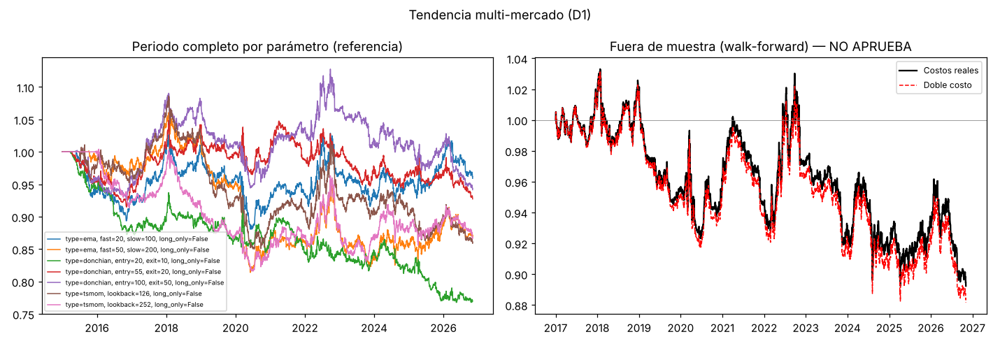
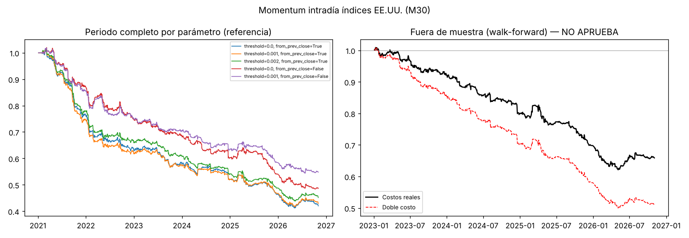
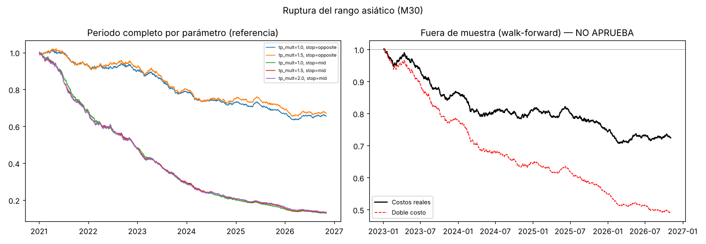

# Informe de investigación

Generado: 2026-11-04 01:52. Costos: spread real x1.0 + deslizamiento 25% del spread; swaps reales de XM. Walk-forward: entrenar 2 años, probar 6 meses.

## Resumen

| familia | veredicto | Sharpe OOS | retorno anual OOS | caída máx. OOS | operaciones OOS |
| --- | --- | --- | --- | --- | --- |
| Tendencia multi-mercado (D1) | NO APRUEBA | -0.18 | -0.9% | 13.6% | 390 |
| Momentum intradía índices EE.UU. (M30) | NO APRUEBA | -1.83 | -10.5% | 38.4% | 2391 |
| Ruptura del rango asiático (M30) | NO APRUEBA | -1.67 | -7.7% | 29.5% | 2446 |

## Tendencia multi-mercado (D1)

**Datos usados**

| símbolo | bars | start | end | gaps_over_4_days | median_spread_bps |
| --- | --- | --- | --- | --- | --- |
| BTCUSD | 3464 | 2015-01-01 | 2026-11-04 | 3 | 17.08 |
| ETHUSD | 3196 | 2016-11-08 | 2026-11-04 | 0 | 21.19 |
| EURUSD | 3109 | 2015-01-02 | 2026-11-04 | 0 | 1.44 |
| GBPUSD | 3109 | 2015-01-02 | 2026-11-04 | 0 | 1.4 |
| GER40Cash | 3010 | 2015-01-02 | 2026-11-04 | 20 | 3.39 |
| GOLD | 3056 | 2015-01-02 | 2026-11-04 | 0 | 1.57 |
| OILCash | 3059 | 2015-01-02 | 2026-11-04 | 0 | 7.54 |
| SILVER | 3057 | 2015-01-02 | 2026-11-04 | 0 | 15.88 |
| US100Cash | 3058 | 2015-01-02 | 2026-11-04 | 1 | 1.62 |
| US30Cash | 3058 | 2015-01-02 | 2026-11-04 | 1 | 1.03 |
| US500Cash | 3058 | 2015-01-02 | 2026-11-04 | 1 | 1.91 |
| USDCHF | 3109 | 2015-01-02 | 2026-11-04 | 0 | 2.08 |
| USDJPY | 3109 | 2015-01-02 | 2026-11-04 | 0 | 1.36 |

**Sensibilidad de parámetros (periodo completo, solo referencia)**

Si solo un parámetro funciona y sus vecinos no, es señal de sobreajuste.

| parámetros | retorno anual | Sharpe | caída máx. | operaciones | factor beneficio |
| --- | --- | --- | --- | --- | --- |
| type=ema, fast=20, slow=100, long_only=False | -0.3% | -0.04 | 14.2% | 480 | 0.95 |
| type=ema, fast=50, slow=200, long_only=False | -1.0% | -0.20 | 23.3% | 236 | 0.71 |
| type=donchian, entry=20, exit=10, long_only=False | -1.8% | -0.41 | 23.2% | 1230 | 0.78 |
| type=donchian, entry=55, exit=20, long_only=False | -0.5% | -0.11 | 11.6% | 566 | 0.91 |
| type=donchian, entry=100, exit=50, long_only=False | -0.4% | -0.08 | 16.5% | 280 | 0.92 |
| type=tsmom, lookback=126, long_only=False | -1.0% | -0.21 | 21.8% | 1299 | 0.83 |
| type=tsmom, lookback=252, long_only=False | -1.0% | -0.21 | 18.7% | 1039 | 0.76 |

### Veredicto: **NO APRUEBA**

Diagnóstico (no cuenta para el veredicto): **sin spread ni deslizamiento** el resultado fuera de muestra sería Sharpe -0.16 y retorno anual -0.8%. Si aquí es positivo y con costos negativo, la idea tiene algo pero los costos de XM se la comen.

| criterio | valor | resultado |
| --- | --- | --- |
| Operaciones fuera de muestra | 390 (mín. 100) | OK |
| Sharpe fuera de muestra | -0.18 (mín. 0.5) | FALLA |
| Eficiencia walk-forward | -0.67 (mín. 0.5) | FALLA |
| Ventanas OOS positivas | 45% (mín. 55%) | FALLA |
| Caída p95 Monte Carlo | 34.4% (máx. 25%) | FALLA |
| Sharpe con doble costo | -0.21 (mín. 0.2) | FALLA |

**Resultado fuera de muestra (walk-forward encadenado)**

| periodo | retorno anual | volatilidad anual | Sharpe | caída máx. | operaciones | % ganadoras | factor beneficio | retorno anual IS (promedio) |
| --- | --- | --- | --- | --- | --- | --- | --- | --- |
| 2017-01-01 a 2026-11-04 | -0.9% | 4.4% | -0.18 | 13.6% | 390 | 31.8% | 1.29 | 1.4% |

**Monte Carlo (2000 caminos)**

| prob. de terminar en pérdida | retorno total (peor 5%) | retorno total (mediana) | caída máx. (mediana) | caída máx. (peor 5%) |
| --- | --- | --- | --- | --- |
| 78.1% | -30.4% | -10.7% | 20.3% | 34.4% |

**Parámetros elegidos por ventana**: type=donchian, entry=100, exit=50, long_only=False (7 veces); type=donchian, entry=55, exit=20, long_only=False (6 veces); type=tsmom, lookback=252, long_only=False (3 veces); type=ema, fast=50, slow=200, long_only=False (2 veces); type=ema, fast=20, slow=100, long_only=False (2 veces)

Detalle por ventana

| test_start | test_end | chosen_params | train_sharpe | test_return | test_sharpe | test_trades |
| --- | --- | --- | --- | --- | --- | --- |
| 2017-01-01 | 2017-06-30 | type=ema, fast=50, slow=200, long_only=False | -0.24 | 0.0031 | 0.16 | 6 |
| 2017-07-01 | 2017-12-31 | type=donchian, entry=55, exit=20, long_only=False | 0.24 | 0.0054 | 0.36 | 22 |
| 2018-01-01 | 2018-06-30 | type=donchian, entry=100, exit=50, long_only=False | 1.38 | -0.0176 | -0.63 | 11 |
| 2018-07-01 | 2018-12-31 | type=donchian, entry=100, exit=50, long_only=False | 1.2 | 0.0234 | 1.1 | 10 |
| 2019-01-01 | 2019-06-30 | type=donchian, entry=100, exit=50, long_only=False | 1.18 | -0.0462 | -2.72 | 21 |
| 2019-07-01 | 2019-12-31 | type=donchian, entry=55, exit=20, long_only=False | 0.17 | -0.0127 | -0.67 | 21 |
| 2020-01-01 | 2020-06-30 | type=donchian, entry=55, exit=20, long_only=False | -0.05 | -0.0309 | -0.62 | 31 |
| 2020-07-01 | 2020-12-31 | type=donchian, entry=55, exit=20, long_only=False | -0.25 | 0.0377 | 1.93 | 16 |
| 2021-01-01 | 2021-06-30 | type=donchian, entry=55, exit=20, long_only=False | -0.23 | 0.0244 | 1.21 | 25 |
| 2021-07-01 | 2021-12-31 | type=donchian, entry=55, exit=20, long_only=False | 0.17 | -0.0396 | -2.43 | 32 |
| 2022-01-01 | 2022-06-30 | type=donchian, entry=100, exit=50, long_only=False | 0.22 | 0.0637 | 1.54 | 9 |
| 2022-07-01 | 2022-12-31 | type=donchian, entry=100, exit=50, long_only=False | 1.37 | -0.0318 | -0.67 | 15 |
| 2023-01-01 | 2023-06-30 | type=donchian, entry=100, exit=50, long_only=False | 0.57 | -0.0085 | -0.53 | 14 |
| 2023-07-01 | 2023-12-31 | type=donchian, entry=100, exit=50, long_only=False | 0.25 | -0.0358 | -1.52 | 19 |
| 2024-01-01 | 2024-06-30 | type=ema, fast=20, slow=100, long_only=False | 0.07 | 0.0145 | 0.51 | 18 |
| 2024-07-01 | 2024-12-31 | type=tsmom, lookback=252, long_only=False | -0.06 | -0.0316 | -0.9 | 50 |
| 2025-01-01 | 2025-06-30 | type=tsmom, lookback=252, long_only=False | -0.03 | 0.0042 | 0.16 | 26 |
| 2025-07-01 | 2025-12-31 | type=tsmom, lookback=252, long_only=False | 0.23 | 0.0142 | 0.58 | 25 |
| 2026-01-01 | 2026-06-30 | type=ema, fast=50, slow=200, long_only=False | 0.45 | -0.0047 | -0.11 | 3 |
| 2026-07-01 | 2026-11-04 | type=ema, fast=20, slow=100, long_only=False | 0.36 | -0.0368 | -2.5 | 16 |

**Por símbolo (periodo completo, parámetro más elegido: type=donchian, entry=100, exit=50, long_only=False)**

| símbolo | retorno anual | Sharpe | caída máx. | operaciones |
| --- | --- | --- | --- | --- |
| BTCUSD | 6.5% | 0.61 | 26.4% | 21 |
| ETHUSD | 8.5% | 0.75 | 24.4% | 17 |
| EURUSD | -3.7% | -0.36 | 39.8% | 26 |
| GBPUSD | -1.4% | -0.09 | 39.1% | 22 |
| GER40Cash | -4.5% | -0.47 | 44.7% | 23 |
| GOLD | 0.9% | 0.13 | 37.4% | 20 |
| OILCash | -1.8% | -0.09 | 43.1% | 21 |
| SILVER | -2.5% | -0.19 | 43.4% | 22 |
| US100Cash | -3.1% | -0.33 | 32.0% | 24 |
| US30Cash | -4.1% | -0.38 | 45.8% | 22 |
| US500Cash | -0.7% | -0.04 | 18.3% | 17 |
| USDCHF | -5.8% | -0.72 | 55.7% | 24 |
| USDJPY | -0.3% | 0.02 | 33.4% | 21 |

## Momentum intradía índices EE.UU. (M30)

**Datos usados**

| símbolo | bars | start | end | gaps_over_4_days | median_spread_bps |
| --- | --- | --- | --- | --- | --- |
| US500Cash | 68865 | 2021-01-04 | 2026-11-04 | 0 | 1.02 |
| US100Cash | 68865 | 2021-01-04 | 2026-11-04 | 0 | 1.29 |
| US30Cash | 68865 | 2021-01-04 | 2026-11-04 | 0 | 1.05 |

**Sensibilidad de parámetros (periodo completo, solo referencia)**

Si solo un parámetro funciona y sus vecinos no, es señal de sobreajuste.

| parámetros | retorno anual | Sharpe | caída máx. | operaciones | factor beneficio |
| --- | --- | --- | --- | --- | --- |
| threshold=0.0, from_prev_close=True | -14.0% | -2.14 | 59.1% | 4282 | 0.72 |
| threshold=0.001, from_prev_close=True | -13.7% | -2.15 | 58.9% | 3667 | 0.69 |
| threshold=0.002, from_prev_close=True | -12.9% | -2.13 | 56.8% | 3064 | 0.66 |
| threshold=0.0, from_prev_close=False | -11.8% | -1.82 | 52.6% | 4282 | 0.76 |
| threshold=0.001, from_prev_close=False | -9.9% | -1.69 | 46.6% | 3086 | 0.74 |

### Veredicto: **NO APRUEBA**

Diagnóstico (no cuenta para el veredicto): **sin spread ni deslizamiento** el resultado fuera de muestra sería Sharpe -0.69 y retorno anual -4.2%. Si aquí es positivo y con costos negativo, la idea tiene algo pero los costos de XM se la comen.

| criterio | valor | resultado |
| --- | --- | --- |
| Operaciones fuera de muestra | 2391 (mín. 100) | OK |
| Sharpe fuera de muestra | -1.83 (mín. 0.5) | FALLA |
| Eficiencia walk-forward | n/d (IS ≤ 0) | FALLA |
| Ventanas OOS positivas | 0% (mín. 55%) | FALLA |
| Caída p95 Monte Carlo | 46.7% (máx. 25%) | FALLA |
| Sharpe con doble costo | -2.95 (mín. 0.2) | FALLA |

**Resultado fuera de muestra (walk-forward encadenado)**

| periodo | retorno anual | volatilidad anual | Sharpe | caída máx. | operaciones | % ganadoras | factor beneficio | retorno anual IS (promedio) |
| --- | --- | --- | --- | --- | --- | --- | --- | --- |
| 2023-01-05 a 2026-11-03 | -10.5% | 6.0% | -1.83 | 38.4% | 2391 | 45.0% | 0.75 | -9.5% |

**Monte Carlo (2000 caminos)**

| prob. de terminar en pérdida | retorno total (peor 5%) | retorno total (mediana) | caída máx. (mediana) | caída máx. (peor 5%) |
| --- | --- | --- | --- | --- |
| 100.0% | -45.5% | -34.3% | 36.0% | 46.7% |

**Parámetros elegidos por ventana**: threshold=0.001, from_prev_close=False (3 veces); threshold=0.001, from_prev_close=True (3 veces); threshold=0.0, from_prev_close=False (2 veces)

Detalle por ventana

| test_start | test_end | chosen_params | train_sharpe | test_return | test_sharpe | test_trades |
| --- | --- | --- | --- | --- | --- | --- |
| 2023-01-05 | 2023-07-04 | threshold=0.0, from_prev_close=False | -2.04 | -0.0314 | -1.31 | 366 |
| 2023-07-05 | 2024-01-04 | threshold=0.0, from_prev_close=False | -1.98 | -0.0556 | -2.17 | 381 |
| 2024-01-05 | 2024-07-04 | threshold=0.001, from_prev_close=False | -1.6 | -0.0613 | -2.65 | 224 |
| 2024-07-05 | 2025-01-04 | threshold=0.001, from_prev_close=True | -1.17 | -0.0695 | -2.48 | 307 |
| 2025-01-05 | 2025-07-04 | threshold=0.001, from_prev_close=True | -1.44 | -0.0323 | -0.83 | 335 |
| 2025-07-05 | 2026-01-04 | threshold=0.001, from_prev_close=False | -0.94 | -0.0992 | -3.75 | 255 |
| 2026-01-05 | 2026-07-04 | threshold=0.001, from_prev_close=True | -1.48 | -0.0415 | -1.14 | 332 |
| 2026-07-05 | 2026-11-03 | threshold=0.001, from_prev_close=False | -1.34 | -0.013 | -0.71 | 191 |

**Por símbolo (periodo completo, parámetro más elegido: threshold=0.001, from_prev_close=False)**

| símbolo | retorno anual | Sharpe | caída máx. | operaciones |
| --- | --- | --- | --- | --- |
| US500Cash | -10.1% | -1.49 | 48.0% | 943 |
| US100Cash | -9.1% | -1.20 | 45.3% | 1128 |
| US30Cash | -10.8% | -1.55 | 50.8% | 1015 |

## Ruptura del rango asiático (M30)

**Datos usados**

| símbolo | bars | start | end | gaps_over_4_days | median_spread_bps |
| --- | --- | --- | --- | --- | --- |
| GOLD | 68988 | 2021-01-04 | 2026-11-04 | 0 | 1.28 |
| EURUSD | 72605 | 2021-01-04 | 2026-11-04 | 0 | 1.51 |
| GBPUSD | 72605 | 2021-01-04 | 2026-11-04 | 0 | 1.5 |

**Sensibilidad de parámetros (periodo completo, solo referencia)**

Si solo un parámetro funciona y sus vecinos no, es señal de sobreajuste.

| parámetros | retorno anual | Sharpe | caída máx. | operaciones | factor beneficio |
| --- | --- | --- | --- | --- | --- |
| tp_mult=1.0, stop=opposite | -6.7% | -1.64 | 37.3% | 3826 | 0.85 |
| tp_mult=1.5, stop=opposite | -6.3% | -1.34 | 35.9% | 3826 | 0.87 |
| tp_mult=1.0, stop=mid | -28.6% | -5.61 | 87.2% | 3826 | 0.60 |
| tp_mult=1.5, stop=mid | -28.4% | -4.88 | 86.9% | 3826 | 0.62 |
| tp_mult=2.0, stop=mid | -28.1% | -4.45 | 86.6% | 3826 | 0.63 |

### Veredicto: **NO APRUEBA**

Diagnóstico (no cuenta para el veredicto): **sin spread ni deslizamiento** el resultado fuera de muestra sería Sharpe 0.55 y retorno anual 2.6%. Si aquí es positivo y con costos negativo, la idea tiene algo pero los costos de XM se la comen.

| criterio | valor | resultado |
| --- | --- | --- |
| Operaciones fuera de muestra | 2446 (mín. 100) | OK |
| Sharpe fuera de muestra | -1.67 (mín. 0.5) | FALLA |
| Eficiencia walk-forward | n/d (IS ≤ 0) | FALLA |
| Ventanas OOS positivas | 12% (mín. 55%) | FALLA |
| Caída p95 Monte Carlo | 39.3% (máx. 25%) | FALLA |
| Sharpe con doble costo | -3.74 (mín. 0.2) | FALLA |

**Resultado fuera de muestra (walk-forward encadenado)**

| periodo | retorno anual | volatilidad anual | Sharpe | caída máx. | operaciones | % ganadoras | factor beneficio | retorno anual IS (promedio) |
| --- | --- | --- | --- | --- | --- | --- | --- | --- |
| 2023-01-04 a 2026-11-04 | -7.7% | 4.8% | -1.67 | 29.5% | 2446 | 44.2% | 0.84 | -6.9% |

**Monte Carlo (2000 caminos)**

| prob. de terminar en pérdida | retorno total (peor 5%) | retorno total (mediana) | caída máx. (mediana) | caída máx. (peor 5%) |
| --- | --- | --- | --- | --- |
| 100.0% | -38.4% | -27.4% | 29.3% | 39.3% |

**Parámetros elegidos por ventana**: tp_mult=1.5, stop=opposite (8 veces)

Detalle por ventana

| test_start | test_end | chosen_params | train_sharpe | test_return | test_sharpe | test_trades |
| --- | --- | --- | --- | --- | --- | --- |
| 2023-01-04 | 2023-07-03 | tp_mult=1.5, stop=opposite | -0.73 | -0.0692 | -2.59 | 341 |
| 2023-07-04 | 2024-01-03 | tp_mult=1.5, stop=opposite | -1.31 | -0.0723 | -2.91 | 339 |
| 2024-01-04 | 2024-07-03 | tp_mult=1.5, stop=opposite | -1.33 | -0.0628 | -2.28 | 330 |
| 2024-07-04 | 2025-01-03 | tp_mult=1.5, stop=opposite | -2.05 | 0.0039 | 0.18 | 337 |
| 2025-01-04 | 2025-07-03 | tp_mult=1.5, stop=opposite | -1.93 | -0.0158 | -0.71 | 294 |
| 2025-07-04 | 2026-01-03 | tp_mult=1.5, stop=opposite | -1.48 | -0.0694 | -2.95 | 312 |
| 2026-01-04 | 2026-07-03 | tp_mult=1.5, stop=opposite | -1.47 | -0.0147 | -0.63 | 286 |
| 2026-07-04 | 2026-11-04 | tp_mult=1.5, stop=opposite | -1.03 | -0.0127 | -0.8 | 207 |

**Por símbolo (periodo completo, parámetro más elegido: tp_mult=1.5, stop=opposite)**

| símbolo | retorno anual | Sharpe | caída máx. | operaciones |
| --- | --- | --- | --- | --- |
| GOLD | -2.8% | -0.40 | 26.1% | 1105 |
| EURUSD | -8.1% | -1.06 | 45.3% | 1353 |
| GBPUSD | -8.5% | -1.12 | 42.7% | 1368 |

